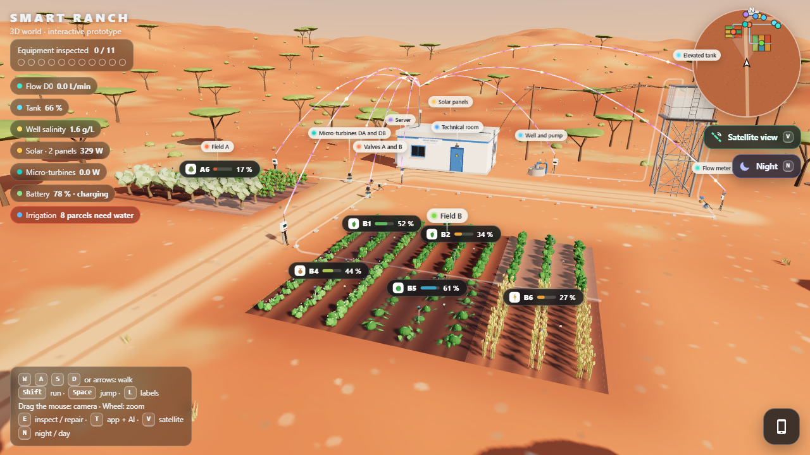
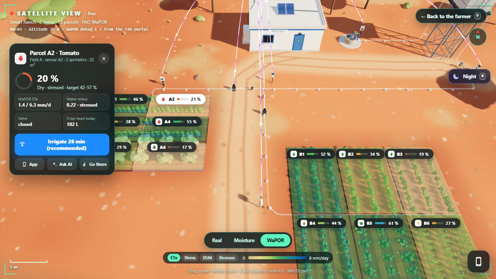
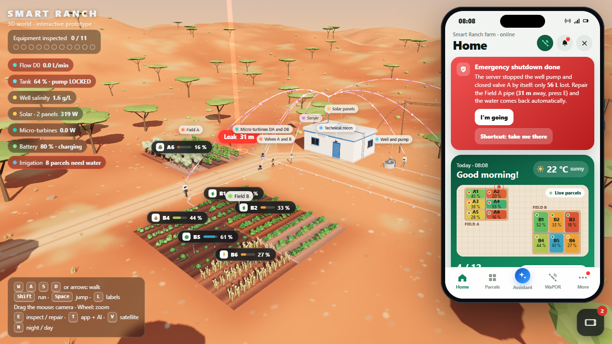
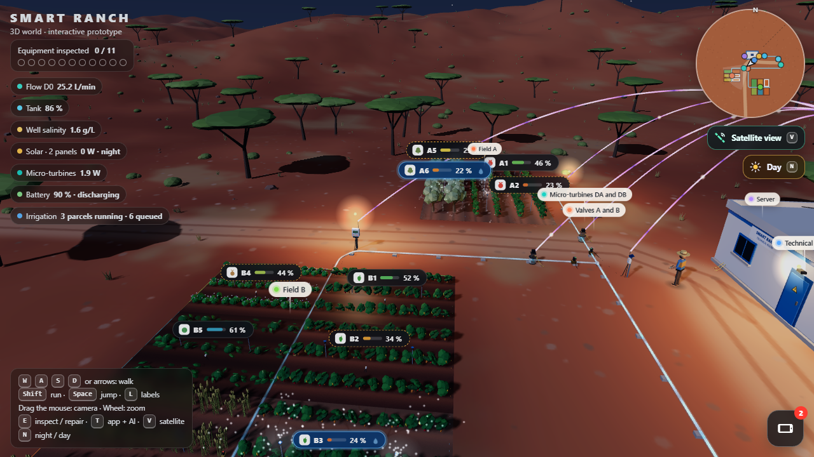
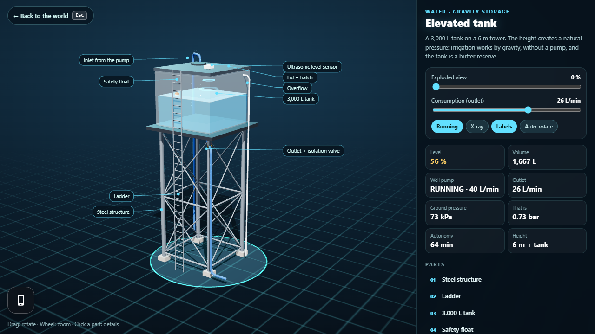
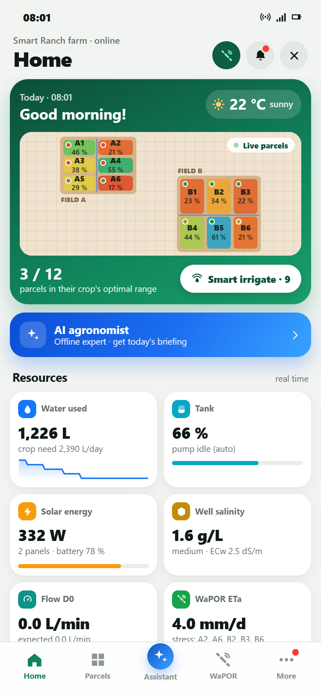
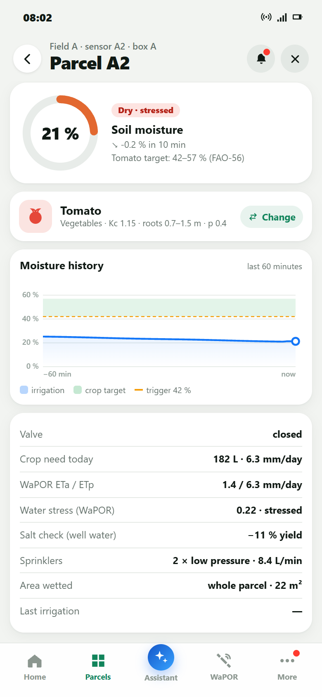
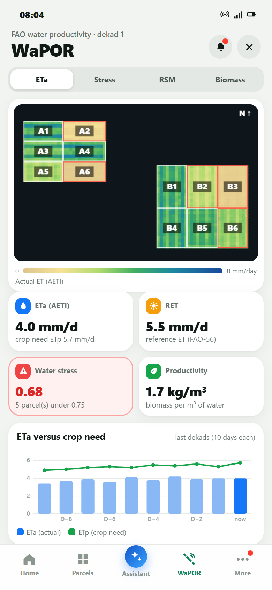
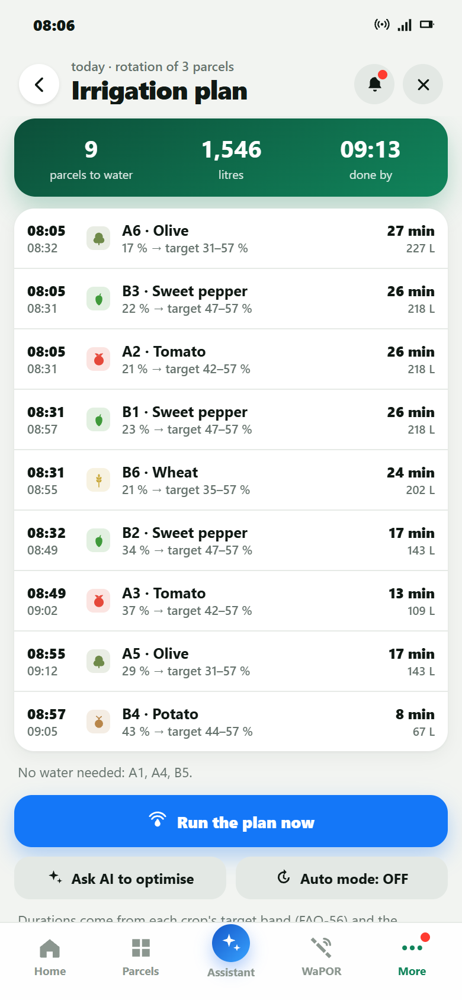
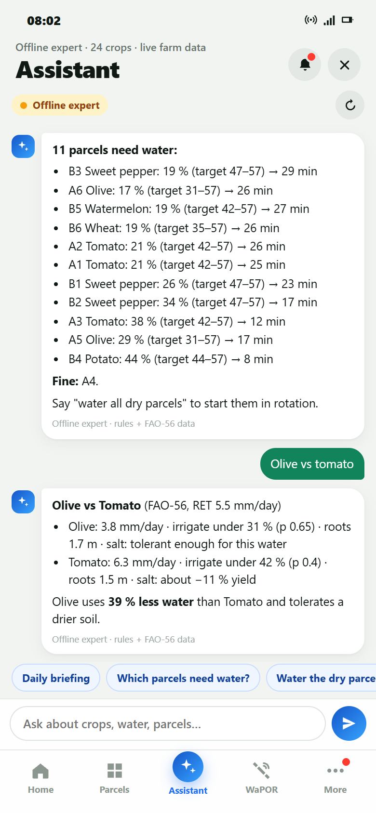

# 🌱 Smart Ranch

**Solar-powered smart irrigation for small farms**: soil sensors, gravity-fed tank, leak protection, FAO-56 crop rules, FAO WaPOR satellite data and an AI agronomist, controlled from a mobile app.

This repository contains two things:

| | What | Where |
|---|---|---|
| 📱 | **Mobile app** (React Native / Expo, TypeScript) | repository root |
| 🌍 | **3D interactive demo** of the farm (single HTML file, three.js) | [`demo/`](demo/) |



---

## 🌍 3D demo

Walk around the farm, inspect every piece of equipment, irrigate from the phone, switch to satellite view, trigger a leak, run the night.

**Run it:** open [`demo/smart-ranch-3d-world.html`](demo/smart-ranch-3d-world.html) in Chrome or Edge (internet needed once, three.js is loaded from a CDN).

| Key | Action |
|---|---|
| `W` `A` `S` `D` / mouse | Walk, turn the camera |
| `E` | Inspect equipment (3D studio) |
| `T` | Open the phone app + AI |
| `V` | Satellite view |
| `N` | Night / day |

| Satellite view with WaPOR layer | Leak protection |
|---|---|
|  |  |

| Night irrigation (battery + micro-turbines) | Equipment studio (elevated tank) |
|---|---|
|  |  |

---

## 📱 Mobile app

<p align="center">
  
  
  
  
  
</p>

- **Home**: live parcel map coloured by moisture versus each crop's target, smart irrigation, KPIs (water, tank, energy, salinity, flow, WaPOR), remote valves and pump, leak card.
- **Parcels**: 12 parcels, moisture history, FAO-56 trigger, salt check, change the crop.
- **Assistant**: AI agronomist (Claude with tools, or an offline expert that speaks English, French and Tunisian Derja).
- **WaPOR**: ETa, water stress, soil moisture and biomass maps, ETa-versus-need history.
- **More**: irrigation plan, water budget, crop library (24 crops), alerts, settings, demo scenarios.
- **Satellite**: Real / Moisture / WaPOR layers with a live scan.

> The mobile app reuses the agronomy rules and the simulation of the 3D demo. The night / energy screen of the 3D demo is not ported yet.

### Run the mobile app

```bash
npm install
npx expo start        # scan the QR code with Expo Go, or press w for web
npx tsc --noEmit      # typecheck
```

To use Claude in the assistant, paste an Anthropic API key in **More › Settings** (stored on the device). Without a key the offline expert answers.

---

## 🧠 How it works

- **Irrigation trigger** (FAO-56): irrigate when moisture < `wilting point + (1 − p) × (field capacity − wilting point)`.
- **Crop need**: `ETc = Kc × RET`; litres per day = `ETc × area / 0.75` (sprinkler efficiency).
- **Salinity**: `ECe = 1.5 × ECw`, yield loss = `b × (ECe − threshold)`.
- **Leak protection**: flow meter D0 compares measured and expected flow; on a mismatch the server locks the pump and closes the valve of the leaking line.
- **WaPOR**: ETa, ETp and stress (`ETa / ETp < 0.75`) per parcel, from a simulated dekadal satellite pass.
- Sensor, flow, weather and satellite values are **simulated** (1 real second = 1 game minute).

## 🗂 Structure

```
App.tsx              app shell (header, tabs, banners, game loop)
src/sim/             farm simulation engine (state, helpers, engine)
src/ai/              Claude tool loop + offline expert
src/screens/         Home, Parcels, WaPOR, More, Assistant, Satellite…
src/ui/              charts, maps, icons, UI kit
src/data/            crop library (FAO-56), farm geometry, icons
demo/                3D interactive demo (single HTML file)
docs/                analysis and plan, screenshots
```

See [`docs/ANALYSIS_AND_PLAN.md`](docs/ANALYSIS_AND_PLAN.md) for the full analysis of the prototype and the roadmap.

## 📄 License

MIT
